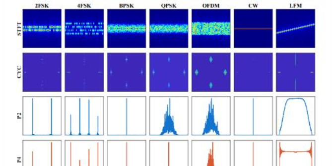

# SCP-TriCA: Trimodal Cross Attention Fusion, Breakthrough in Distributed Offset Issues of Underwater Acoustic Modulation Recognition[with Python code]

SCP-TriCA: Trimodal Cross-Attention Fusion to Break Through the Distributional Bias of Underwater Acoustic Modulation Recognition
Underwater Acoustic Modulation Recognition (UAMR) is a core technology in applications such as marine monitoring and underwater communication reconnaissance. However, in practical deployments, issues like low signal-to-noise ratio, unknown propagation environments, and unseen communication parameters severely constrain the generalization capabilities of recognition systems. This paper introduces the UAMR-ShiftBench benchmark test platform and the SCP-TriCA model, providing a novel solution for intelligent underwater acoustic recognition. 01 Research Background: Realistic Challenges in Underwater Acoustic Modulation Recognition
Underwater acoustic communication is the primary means of transmitting information in the ocean.Underwater Acoustic Modulation Recognition (UAMR) aims to automatically identify the modulation method used in received acoustic signals, such as BPSK, QPSK, OFDM, etc. It is a key technical link in spectrum monitoring, electronic reconnaissance, and underwater communication countermeasures.
In recent years, deep learning has made significant progress in UAMR tasks. However, existing work mostly focuses on the same distribution testing scenarios, i.e., training and testing data come from the same hydroacoustic channel conditions and communication parameter settings. In actual marine environments, the following distribution offset factors are prevalent:
Signal-to-Noise Ratio Variation: Significant fluctuations in the SNR of received signals due to changes in deep sea environments;
Differential Communication Environment: The hydrological conditions in different seas and seasons are vastly different.
Communication parameter changes: Carrier frequency, symbol rate, bandwidth and so on are very different in real scenes;
The chasm between measured data and simulated data: Simulated data cannot fully simulate the complexity of real oceanic channels.
UAMR-ShiftBench is specifically designed to be a systematic benchmark testing platform, while SCP-TriCA is an identification model that performs exceptionally well on this platform.
02 UAMR-ShiftBench: Systematic Distribution Offset Benchmarking UAMR-ShiftBench covers seven categories of mainstream underwater acoustic modulation signals recognition tasks.
Tags
Modulation type
Notes
0  
2FSK binary frequency shift keying
1  
4FSK Quaternary Frequency Shift Keying
2  
BPSK Binary Phase Shift Keying
3  
QPSK Quadrature Phase Shift Keying
4  
OFDM orthogonal frequency division multiplexing
5  
CW continuous wave
6  
LFM Linear Frequency Modulation
To comprehensively assess the robustness of the model under different distribution shifts, the benchmark test will divide the dataset into five test scenarios:
Dataset
Meaning
Assessment objectives
D1 Same distribution test set
Standard recognition capability
D2 Low Signal-to-Noise Ratio Test Set
Noise robustness
D3 Unknown Environment Test Set
Generalization ability in the transmission environment
D4 Unknown Communication Parameters Test Set
Generalization capability of communication parameters
Sea-trial data of the South China Sea (March & November)
Real-scene verification
Baseline parameters configuration sampling rate: 128 kHz
Signal duration: approximately 3 seconds (SCP-TriCA uses 1 second segments)
Frequency coverage: 0.8 ~ 25 kHz
Simulation Distribution Offset: Low SNR, Unknown Environment, Unknown Communication Parameters
Measured data: Data collected in March and November in the shallow waters of the South China Sea
This multi-level evaluation system, which starts from shallow to deep and simulates to measure, provides a comprehensive examination of the model's generalization ability.
03 SCP-TriCA Model: Hierarchical Fusion of Heterogeneous Signal Representations 3.1 Core Concept The core concept of the SCP-TriCA model is that signals from different categories carry complementary discriminative information. Single modality (such as only using time-frequency plots) is difficult to handle multiple distribution offsets simultaneously; And effectively integrate heterogeneous representations. It can significantly enhance the model's robustness and generalization capabilities.
The three signal representation modalities of model fusion are as follows:
STFT Time-frequency diagram (224×224): Classical time-frequency analysis result, intuitively reflecting the signal's spectral time evolution law;
Cyclic Stable Graph (224×224): Two-dimensional features extracted from cyclic stable analysis, capturing the periodic statistical characteristics of signals.
P2/P4 Power Spectrum (1024×2): A statistical feature vector composed of second-order and fourth-order power spectra, characterizing the high-order statistical information of signals.
These three modalities cover three complementary feature spaces: time-frequency domain, recurrent stationary domain, and high-order statistical domain.
3.2 Detailed Explanation of Model Architecture SCP-TriCA adopts a hierarchical cross-attention fusion strategy, organically integrating 2D and 1D signal representations into a compact classification feature.
┌─────────────────┐              │ Classification │              │   Head   │              └────────┬────────┘                  │             ┌──────────┴──────────┐             │ Adaptive Gate   │             │ Fusion (Stage 2) │             └──────────┬──────────┘                  │       ┌──────────────────────┼──────────────────────┐       │           │           │  ┌────────┴────────┐ ┌────────┴────────┐ ┌────────┴────────┐  │ STFT Encoder │ │ CYC Encoder │ │ P2/P4 Encoder │  │ (CNN+ViT)   │ │ (CNN+ViT)  │ │ (1D Conv+TF) │  └────────┬────────┘ └────────┬────────┘ └────────┬────────┘       │           │           │  ┌────────┴────────┐ ┌────────┴────────┐ ┌────────┴────────┐  │ STFT Feature │ │ CYC Feature │ │ P2/P4 Feature │  │  (224×224)  │ │  (224×224)  │ │ (1024×2)   │  └─────────────────┘ └─────────────────┘ └─────────────────┘\nPhase 1: 2D Modality Inter-Cross AttentionSTFT The steady-state graphs of the and loops are each passed through independently. CNN Backbone network (MultiScaleResidualBlock Stacking) extract the feature maps, and then pass through ViT Style Token Module: Convert feature maps to token Sequence (including) CLS token, 8×8=64 A space token)。  
Subsequently, bidirectional CLS guided cross-attention is performed:  
STFT's CLS token queries the patch tokens of CYC, updating STFT CLS;  
CYC's CLS token queries the patch tokens of STFT, updating CYC CLS.  
The two updated CLS tokens are concatenated and fused into a unified 2D feature representation through (Linear → BatchNorm → ReLU).  
In the second stage: 2D→1D cross-attention + adaptive gate-controlled P2/P4 power spectrum extraction through a 1D convolutional encoder (three layers of Conv1d → AdaptiveAvgPool → Transformer Encoder) to extract a sequence of 1D tokens.  
The fused 2D CLS is projected onto the P2/P4 feature space, then cross-attention queries the P2/P4 token sequences to obtain enhanced CLS representations with statistical features.  
Finally, an **Adaptive Selective Gate** controls the degree of injection of P2/P4 statistical evidence:  
Wherein the gate value (g = \sigma(\text{GateNet}([\text{CLS}{\text{2D}}, \text{CLS}{\text{P2/P4}}]))) is dynamically determined by the current sample's features. This means:  
When 2D features are sufficient for discrimination, the gate reduces the involvement of P2/P4;  
When 2D features are unreliable due to distribution shifts, the gate relies more on statistical features.  
The final CLS after fusion is output by the classification head with 7 class probabilities.
3.3 Key Design Highlights and Design Points
Techniques
Functions
Heterogeneous Fusion of 2D Time-frequency Figure + 1D Statistical Metrics
Complementary Information Covers Multiple Feature Domains
Two-Stage Cross Attention 2D-2D → 2D-1D Hierarchical Transmission
Orderly, Efficient Information Exchange
Adaptive Sigmoid Gate Network for Samples
Dynamic Trade-off between Modal Importance
Multi-Scale Residual Module 3×3 + 5×5 Dual-branch Convolution
Enhanced Robustness in Feature Extraction
04 Experiments and Evaluation
SCP-TriCA was evaluated on all five test scenarios of UAMR-ShiftBench:
D1 (Same distribution): Assesses the model's basic recognition capability;
D2 (Low SNR): Examines the model's robustness under poor signal-to-noise ratio;
D3 (Unknown Environment): Tests the model's generalization to unseen propagation environments, using the SNR segmented equal precision metric (-80 dB and 020 dB);
D4 (Unknown Communication Parameters): Tests the model's generalization to unseen communication parameters, also using the SNR segmented equal precision metric;
Sea-trial (Real Data): Verifies the model's performance on real data from the South China Sea.
The inference interface project provides complete inference code, using a simple CSV driver interface:
# Method 1: Specify the dataset directory.python infer_csv.py \ --dataset-dir /path/to/dataset \ --checkpoint model/scp_trica_best.pt \ --output-dir /path/to/run_dir# Method 2: Explicitly specified CSV Filepython infer_csv.py \ --csv D1=/path/to/labels_D1_test.csv D2=/path/to/labels_D2.csv \ --checkpoint model/scp_trica_best.pt \ --output-dir /path/to/run_dir\nOutput will automatically generate CSV files for each sample's prediction results, confusion matrices, SNR-precision curves, and a summary table in the paper format.
05 Technical Details Overview of the Project
Details
Title: Heterogeneous 2D/1D Signal Representation Fusion for Underwater Acoustic Modulation Recognition Under Distribution Shift
Authors: Ronglai Qian, Liang An, Xiaoyan Wang, Qing Fan, Ziwei Huang, Yang Ye
Journal: IEEE Transactions on Image Processing (TIP)
Framework: PyTorch 2.8.0, CUDA 12.8
Python version: 3.10
Input dimensions: STFT (1×224×224), CYC (1×224×224), P2 (1024), P4 (1024)
Output: 7-class soft label probabilities
Model parameters: p2p4_dim=192, p2p4_tokens=64, token_hw=8×8, cross_heads=4, dropout=0.3
06 Summary and Prospects
UAMR-ShiftBench and SCP-TriCA jointly established a set of distribution shift robustness evaluation and solution frameworks for underwater acoustic modulation recognition:
1. UAMR-ShiftBench provides a complete evaluation system from the same distribution to multiple types of distribution shifts, and from simulation to real measurements, setting high standards for UAMR research;
2. SCP-TriCA demonstrates excellent robustness in different distribution shift scenarios through hierarchical cross attention fusion with three-modality heterogeneous signal representation and sample adaptive gating mechanisms;
3.
The project has made the inference code and pre-trained model weights open-source, with the dataset to be officially released in the subsequent phase. 
Underwater acoustic intelligent recognition is moving from "labs" to the ocean. We look forward to UAMR-ShiftBench and SCP-TriCA providing robust research benchmarks and methodologies for the field of underwater acoustic communication recognition.

## Images

<!-- PAYMENT_BLOCK -->

## Get this dataset

- Payment link (Stripe): [Buy now](https://buy.stripe.com/3cs8yP7sY87d0vu9AB)
- Payment QR code: 

<!-- /PAYMENT_BLOCK -->
